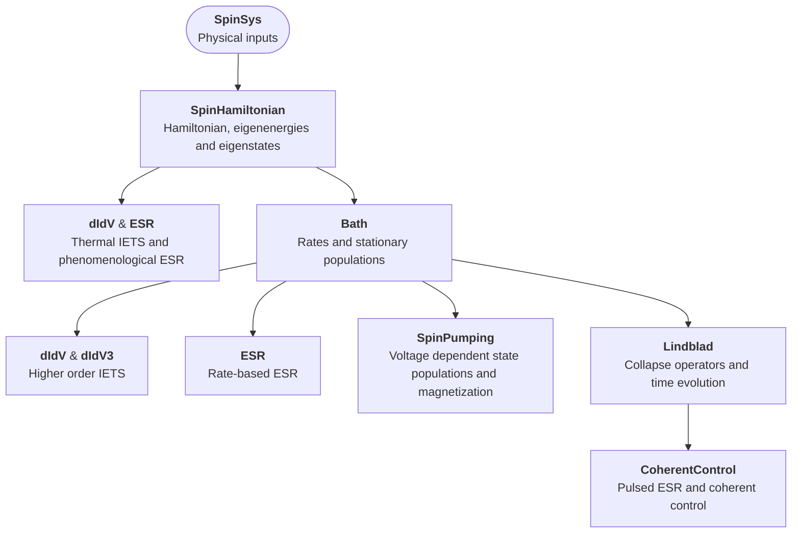

# User guide

This guide explains how **Spinfinity** is organized, which modules to use,
and how to move from model parameters to calculated results.

Start with [Installation](installation.md) if the package is not installed.
Use this page as a map, then follow the [tutorials](#continue-with-the-tutorials)
for complete worked examples. The [API documentation](documentation.md)
provides function signatures, parameters, return values and implementation details.

## The central object: SpinSys

A `SpinSys` object holds the physical inputs and the results needed by
the calculation modules. Most workflows reuse the same object, conventionally
named `spin`.

For example, `SpinSys([0.5])` represents one spin-1/2;
`SpinSys([1.0, 0.5])` represents a spin-1 site coupled to a spin-1/2 site.
Spin indices start at zero. The Hilbert-space dimension is the product of
`2*S + 1` over all sites.

Typical inputs include:

- `B` and `BTip`: external and tip magnetic fields.
- `gfactorvector`, `Dvector` and interaction parameters: the spin Hamiltonian.
- `T`, `V_DC`, conductances and reservoir polarizations: the electron bath.
- `ReadoutSpin`: the site addressed by the tip and coherent drive.

Calculation functions subsequently attach results such as `H`,
`E_All`, `eigVectors`, `Rates` and `Populations`. These quantities are
not all calculated when the object is created.

See the [SpinSys reference](api/spinsys.md) for the available attributes.

## Modules and use cases

| Module | What to use it for |
|---|---|
| [`SpinSys`](api/spinsys.md) | Define the spin sites and store model inputs and calculated results. |
| [`SpinHamiltonian` (`hamil`)](api/spinhamiltonian.md) | Construct spin operators and Hamiltonians; calculate energies and eigenstates. Includes Zeeman fields, anisotropy, exchange, dipolar, hyperfine, quadrupolar and Stevens terms. |
| [`Bath` (`bath`)](api/bath.md) | Calculate electron-scattering rates, thermal or pumped populations, tunnel current and eigenstate escape lifetimes. |
| [`dIdV`](api/dIdV.md) | Calculate and plot IETS spectra. Choose thermal second order (`"2nd"`) or a rate-equation treatment (`"2ndR"`); the plotting interface also dispatches third-order modes. |
| [`dIdV3`](api/dIdV3.md) | Add perturbative third-order corrections, using thermal populations (`"3rd"`) or corrected stationary rate equations (`"3rdR"`). This is a weak-coupling treatment, not a strong-coupling Kondo solver. |
| [`ESR`](api/esr.md) | Calculate continuous-wave ESR spectra and tip-field maps. Choose phenomenological lines or a driven steady-state rate model. |
| [`SpinPumping`](api/spinpumping.md) | Explore voltage-dependent populations, rates and magnetization; project coupled-system populations onto subsystem states. |
| [`Lindblad` (`lind`)](api/lindblad.md) | Construct inelastic and phenomenological dephasing collapse operators; simulate dissipative time evolution and analyze its observables. |
| [`CoherentControl` (`CC`)](api/coherentcontrol.md) | Simulate driven pulse experiments using rotating-frame descriptions: Rabi, Ramsey, Hahn echo and ESEEM. |
| [`Eigensystem_Import`](api/eigensystem_import.md) | Parse energies, state compositions and Stevens coefficients from supported CASSCF/RASSI output. This is a separate parser, not an automatic replacement of a `SpinSys` eigensystem. |
| [`helperfunctions`](documentation.md#helperfunctions) | Fit symmetric spectral peaks or dips, exponential decays and damped oscillations. |
| [`plotting`](documentation.md#plot-display-settings) | Set global or per-call display modes for the package's Plotly figures. |

## How calculations fit together

The usual starting point is a solved Hamiltonian. Subsequent steps depend
on the observable of interest; not every calculation requires every branch.



Typical calculation workflow. The arrows indicate how calculated quantities
feed subsequent analyses, not an exhaustive internal function-call graph.


## Quick example: a spin-1/2 ESR spectrum

The following example defines a single spin, solves its Hamiltonian and
calculates a phenomenological ESR spectrum. A small tilted tip field gives
nonzero transition and detection weights.

```python
import numpy as np

from spinfinity import ESR, SpinSys, bath, hamil

spin = SpinSys([0.5])
spin.B = [0.0, 0.0, 0.5]  # T
spin.BTip = [0.01, 0.0, 0.01]  # T
spin.gfactorvector = [2.0]
spin.T = 0.5  # K

hamil.calc_EigStates(spin, rebuildH=True)
bath.calc_Populations(spin, AllowPumping=False)

resonance = spin.E_All_inGHz[1] - spin.E_All_inGHz[0]
frequencies = np.linspace(resonance - 0.2, resonance + 0.2, 1001)
frequencies, signal = ESR.calc_FreqSweep(
    spin,
    freq_array=frequencies,
    lw=0.02,  # GHz; FWHM
    norm=False,
    output=False,
)

print("Relative energies (meV):", spin.E_All)
print(f"Transition frequency: {resonance:.6f} GHz")
print("Spectrum shape:", signal.shape)
```

`E_All` contains energies relative to the ground state; the columns of
`eigVectors` are the corresponding eigenvectors in the product-spin basis.

The [first Hamiltonian tutorial](tutorials/01_first_spin_hamiltonian.ipynb)
explains the eigensystem. The [ESR tutorial](tutorials/04_phenomenological_esr.ipynb)
adds the physical interpretation and a plotted spectrum.


## Continue with the tutorials

The tutorials are practical, sequential examples rather than a second API reference.
For a first visit, begin with the Hamiltonian tutorial, then choose the observable
or experiment you want to simulate.

| Tutorial | What it adds to this guide |
|---|---|
| [First spin Hamiltonian](tutorials/01_first_spin_hamiltonian.ipynb) | Solve and inspect a single-spin eigensystem; change parameters and rebuild. |
| [Two interacting spins](tutorials/02_two_interacting_spins.ipynb) | Assign pair exchange and interpret coupled eigenstates. |
| [IETS](tutorials/03_iets_spin_half.ipynb) | Compare thermal second-order conductance with tunneling-induced pumping. |
| [Phenomenological ESR](tutorials/04_phenomenological_esr.ipynb) | Generate and interpret a Lorentzian ESR spectrum. |
| [Relaxation and time evolution](tutorials/05_relaxation_and_timeevolution.ipynb) | Configure dissipation and simulate relaxation from an initial state. |
| [Rabi oscillations](tutorials/06_rabi_oscillations.ipynb) | Configure a resonant drive and calculate driven population dynamics. |

For more specialized systems, explore the repository's `examples/` notebooks.
Use the [API documentation](documentation.md) when you need exact arguments,
return structures or the assumptions of an individual function.

